<div align="center">

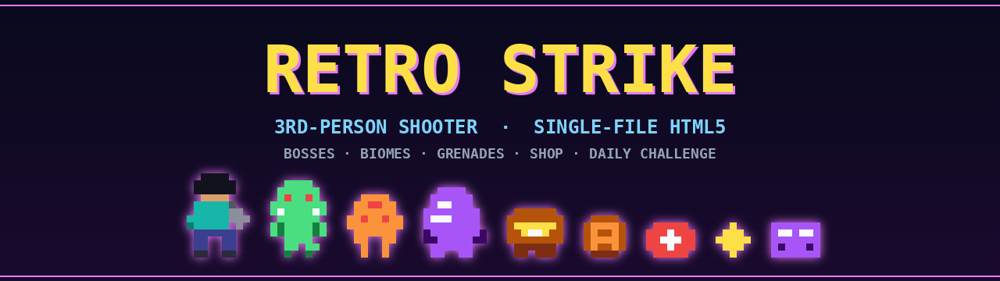

# 🎮 RETRO STRIKE

**A complete retro-styled third-person shooter that lives inside a single HTML file.**
No engine, no build step, no dependencies — a custom software 3D renderer, a chiptune synth and a procedural arena, all in one document.

[](LICENSE)
[](CHANGELOG.md)
[](dist/retro-strike.min.html)
[](#-tech)
[](#-tech)
[](#-tech)
[](#-controls)
[](#-quick-start)
[](#-contributing)

<!-- Dynamic badges — replace drsamonline/retro-strike with your GitHub username + repo name -->
[](https://github.com/drsamonline/retro-strike/stargazers)
[](https://github.com/drsamonline/retro-strike/network/members)
[](https://github.com/drsamonline/retro-strike/issues)
[](https://github.com/drsamonline/retro-strike/commits)

### [▶️ &nbsp;PLAY IN YOUR BROWSER](https://drsamonline.github.io/retro-strike/)

<sub>Point the two links above at your own repo — see <a href="#-publishing">Publishing</a>.</sub>

</div>

---

## 📖 Table of contents

- [✨ Features](#-features)
- [📸 Screenshots](#-screenshots)
- [🎮 Controls](#-controls)
- [🚀 Quick start](#-quick-start)
- [📦 Project structure](#-project-structure)
- [🛠️ Tech](#-tech)
- [⚡ Performance](#-performance)
- [🚢 Publishing](#-publishing)
- [🗺️ Roadmap](#-roadmap)
- [🤝 Contributing](#-contributing)
- [📄 License](#-license)

---

## ✨ Features

| | |
|---|---|
| 🔫 **4 weapons** | Blaster, Spread (5 pellets), Rifle (full-auto), Beam (piercing) — each with a 3-tier upgrade path |
| 👾 **9 enemy types** | Grunt, Runner, Tank, Splitter, Kamikaze, Shield-bearer, **Sniper** (telegraphed long-range shot) and **Healer** (pulses health to allies), plus elite/gold variants |
| 👹 **Two bosses** | Every 5th wave, with an enraged second phase — the **Summoner** calls in reinforcements |
| 🌍 **Procedural arenas** | Seeded xorshift generator with flood-fill reachability, plazas, lava & ice biomes |
| 🗺️ **8-level campaign** | Hand-crafted layouts with objective variety (survive, find chests, defeat bosses) |
| 🎲 **Custom seeds** | Type a seed on the title screen to replay or share any arena |
| 📅 **Daily Challenge** | A fresh date-seeded arena every day, with its own best-score tracking |
| 👻 **Ghost replay** | Race the spectre of your best run on the same seed |
| 💣 **Throwables** | Grenades, proximity mines and cluster bombs, plus melee and a dash |
| 🛒 **Between-wave shop** | 10 items: medkits, shields, ammo, throwables, weapon upgrades, drone companion |
| 🎛️ **5 wave mutators** | Pea-soup Fog, Swarm, Speed Freaks, Bounty Hunt, Blackout |
| 🌗 **Living world** | Day/night cycle, rain, lightning, glowing lamps, CRT scanlines |
| 🏆 **Progression** | 14 achievements, lifetime stats, hi-score and a top-10 leaderboard |
| 💾 **Persistence** | Auto-save & continue, settings, achievements and scores in `localStorage` |
| 📸 **Photo mode** | Free-orbit camera + one-click PNG score card |
| ♿ **Accessibility** | Big buttons, left-handed layout, large HUD, FOV/sensitivity/crosshair/aim-assist options |
| 🕹️ **Three input schemes** | Keyboard + mouse (pointer lock), touch (dual-stick), and gamepad |

> 🧩 **Everything is one file.** Open `dist/retro-strike.min.html` and you are playing — no server, no install, no network.

---

## 📸 Screenshots

<div align="center">

| 🎯 Sniper (telegraphs its shot) | 💚 Healer (pulses health to allies) |
|:---:|:---:|
| 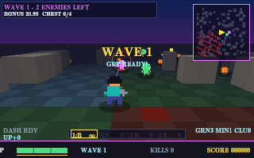 | 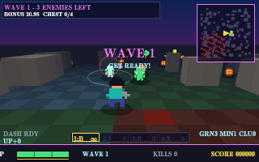 |
| 👹 Summoner boss | 🎮 Combat |
| 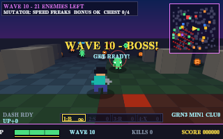 | 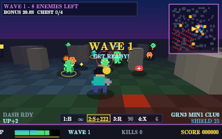 |
| 👹 Boss fight | 🛒 Between-wave shop |
| 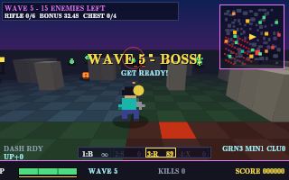 | 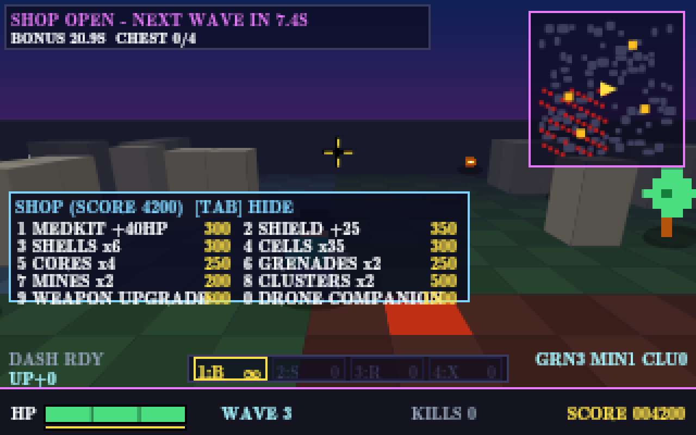 |
| 🗺️ Campaign | 🌙 Night, rain & lightning |
| 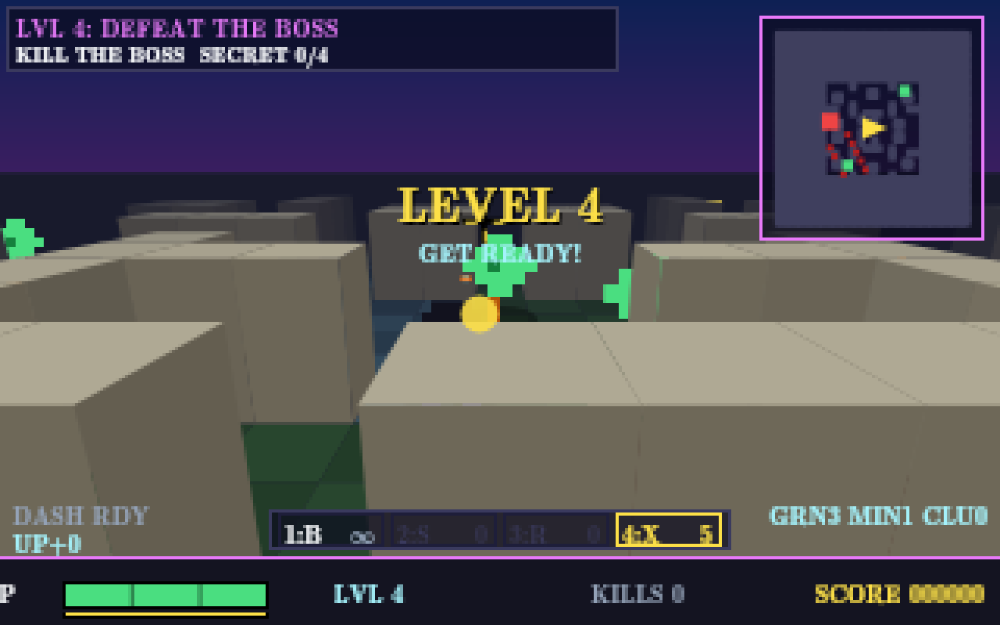 | 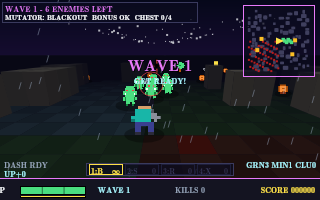 |
| ⚙️ Settings | 🏆 Leaderboard |
| 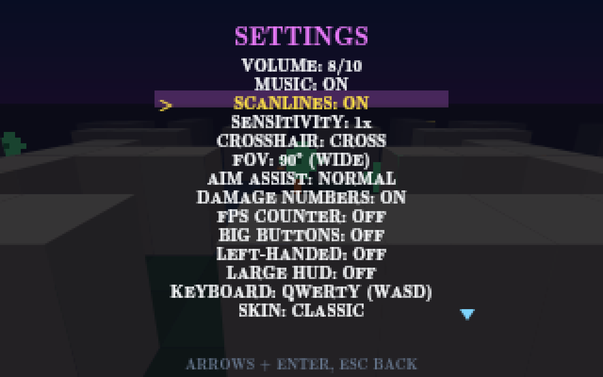 | 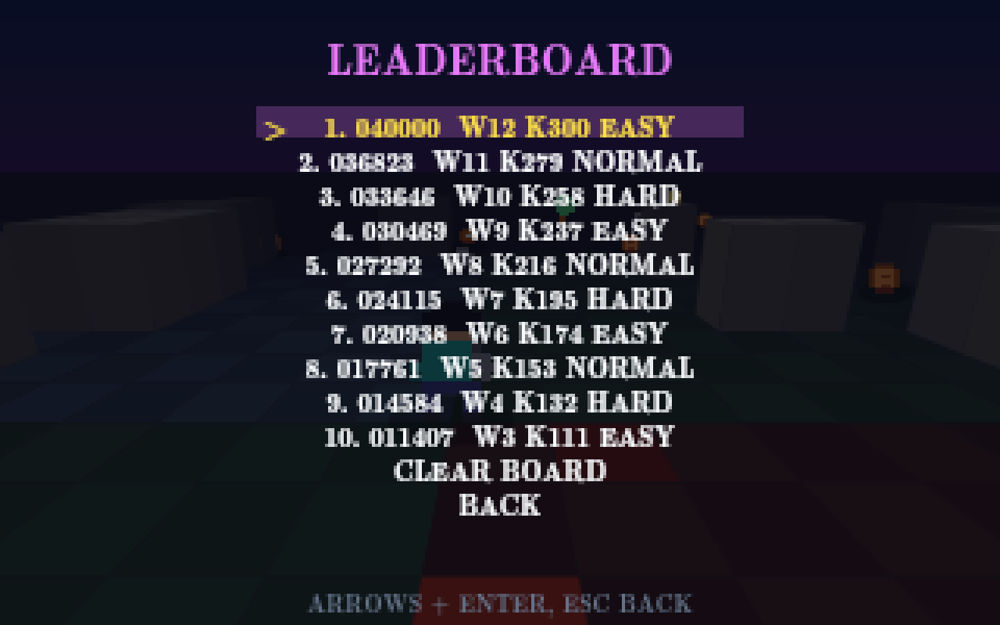 |

<sub>Captured from the live game — the real 320×200 software renderer, 4× nearest-neighbour upscale.</sub>

</div>

---

## 🎮 Controls

<details open>
<summary><b>⌨️ Keyboard &amp; Mouse</b></summary>

| Action | Key |
|---|---|
| Move | `W` `A` `S` `D` |
| Turn | `←` `→` *(or mouse)* |
| Fire | `Space` *(or left mouse)* |
| Sprint | `Shift` |
| Weapon select | `1` `2` `3` `4` |
| Cycle weapon | `X` |
| Grenade / Mine / Cluster | `G` / `B` / `H` |
| Cycle throwable | `T` |
| Melee | `V` |
| Dash | `C` |
| Pause | `Esc` / `P` |
| Mute | `M` |
| Shop (intermission) | `Tab`, buy with `1`–`0` |

</details>

<details>
<summary><b>📱 Touch</b></summary>

- **Left thumb** — virtual joystick to move (push to the edge to sprint)
- **Right thumb** — drag to aim/turn
- **FIRE** button — bottom-right
- **SWAP / NADE / DASH / MEL** — button cluster *(long-press NADE to cycle throwables)*
- **⛶** — fullscreen &nbsp;·&nbsp; tap the top of the screen in Photo Mode to exit

</details>

<details>
<summary><b>🎮 Gamepad</b></summary>

| Action | Button |
|---|---|
| Move / Turn | Left stick / Right stick |
| Fire | RT / RB |
| Swap weapon | LB |
| Throw | X |
| Pause | Start |
| Menus | D-pad + A / B |

</details>

Full reference: [`docs/CONTROLS.md`](docs/CONTROLS.md)

---

## 🚀 Quick start

**Play it now** — open the release file in any modern browser:

```bash
# clone
git clone https://github.com/drsamonline/retro-strike.git
cd REPO

# just open the playable build…
open dist/retro-strike.min.html      # macOS
xdg-open dist/retro-strike.min.html  # Linux
start dist\retro-strike.min.html     # Windows
```

Prefer a local server (needed only for the fullscreen button on some browsers):

```bash
python3 -m http.server 8080
# then visit http://localhost:8080/dist/retro-strike.min.html
```

**Edit the game** — the readable source lives in [`src/retro-strike.html`](src/retro-strike.html). Change it, then rebuild the release:

```bash
npm install     # installs terser (the only dev dependency)
npm run build   # src/retro-strike.html -> dist/retro-strike.min.html
```

---

## 📦 Project structure

```
retro-strike/
├── src/retro-strike.html        # 📜 readable, commented source (edit this)
├── dist/retro-strike.min.html   # 🎮 minified, playable release (~90 KB)
├── tools/build.mjs              # 🔧 minifier (extracts + compresses src -> dist)
├── assets/                      # 🎨 banner, logo, social preview, screenshots
├── docs/                        # 📚 architecture, controls, performance, audit
├── .github/                     # ⚙️ Pages workflow, issue & PR templates
├── package.json                 # 📦 build script (dev-only)
├── CHANGELOG.md · CONTRIBUTING.md · CODE_OF_CONDUCT.md · SECURITY.md
└── LICENSE
```

**Source vs release:** `src/` is the human-readable single file you edit; `dist/` is the same game compressed for shipping. The GitHub Pages workflow publishes `dist/` so the repo is instantly playable online.

---

## 🛠️ Tech

Built from scratch with **zero runtime dependencies** — only web-platform APIs:

- **Renderer** — a hand-written software rasteriser on **Canvas 2D**: per-face camera-space projection, near-plane clipping and a painter's-algorithm depth sort. Sprites are cached to offscreen canvases and blitted in one `drawImage`.
- **Audio** — procedural **chiptune** (bass + arpeggio) and all SFX synthesised live from `OscillatorNode` / noise buffers via the **Web Audio API**.
- **World** — a seeded **xorshift PRNG** for reproducible arenas, flood-fill reachability so nothing spawns in a sealed room, and biome quadrants (default / ice / lava).
- **Persistence** — settings, stats, achievements, leaderboard, campaign progress, run save and ghost replay in **`localStorage`** (every access guarded).
- **Input** — Pointer Lock for mouse aim, multi-touch with a virtual joystick, and the Gamepad API.

---

## ⚡ Performance

The game targets a smooth **~60 FPS** on modest hardware and caps its frame rate so high-refresh displays stay cool.

| Optimisation | Effect |
|---|---|
| Precomputed wall/lava cell lists | Minimap no longer rescans the 48×48 grid twice per frame |
| Quantised fog-colour cache | Avoids ~700 string builds per frame |
| Cached sprite atlases | One `drawImage` per sprite instead of per-pixel fills |
| Distance-culled particles/bullets | Fewer short-lived objects and closures per frame |
| Hoisted palettes & sort comparators | Removes per-frame allocations |
| `dt` clamp + FPS cap | Stable physics on any refresh rate |

See [`docs/PERFORMANCE.md`](docs/PERFORMANCE.md) for the measured before/after.

---

## 🚢 Publishing

1. **Create the repo** and push:

   ```bash
   git init
   git add .
   git commit -m "Initial commit — RETRO STRIKE v1.1.0"
   git branch -M main
   git remote add origin https://github.com/drsamonline/retro-strike.git
   git push -u origin main
   ```

2. **Make the badges yours** — find-and-replace every `drsamonline/retro-strike` in `README.md` with your GitHub username and repo name (the banner, star/issue badges and the **▶️ Play** link all use it).

3. **Turn on the live demo** — go to **Settings → Pages → Build and deployment → Source: GitHub Actions**. The included workflow (`.github/workflows/pages.yml`) deploys the minified build to `https://drsamonline.github.io/retro-strike/` on every push to `main`.

4. **Cut a release** — create a tag and attach `dist/retro-strike.min.html` as the release asset so players can download a single file:

   ```bash
   git tag -a v1.1.0 -m "RETRO STRIKE v1.1.0"
   git push origin v1.1.0
   ```

5. *(Optional)* **Social preview** — upload `assets/social-preview.png` under **Settings → General → Social preview**.

---

## 🗺️ Roadmap

> 🧍 **Single-player only — permanently.** RETRO STRIKE has no servers, accounts, matchmaking or networking of any kind, and none are planned. Every item below runs entirely in your browser.

**Shipped in v1.3.0**

- [x] New enemy archetypes — the **Sniper** (holds a lane and telegraphs a long-range shot) and the **Healer** (pulses health to nearby allies)
- [x] A second boss — the **Summoner**, which calls in reinforcements mid-fight
- [x] **Custom arena seeds** — type any seed on the title screen to replay an arena

**Planned**

- [ ] Additional campaign chapters (levels 9–12)
- [ ] Controller remapping UI
- [ ] More accessibility presets (colour-blind palettes, adjustable HUD scale)
- [ ] Optional WebGL renderer for very large arenas
- [ ] Boss bestiary / in-game codex

Have an idea? [Open a feature request](issues/new?template=feature_request.md).

---

## 🤝 Contributing

Contributions are welcome — bug reports, balance tweaks, new content. Please read [`CONTRIBUTING.md`](CONTRIBUTING.md) and the [`CODE_OF_CONDUCT.md`](CODE_OF_CONDUCT.md) first.

Found a security issue? See [`SECURITY.md`](SECURITY.md).

---

## 📄 License

Released under the **MIT License** — see [`LICENSE`](LICENSE).

<sub>Art, code and sound are original to this project. Built as a single-file web game; not affiliated with any commercial title.</sub>
